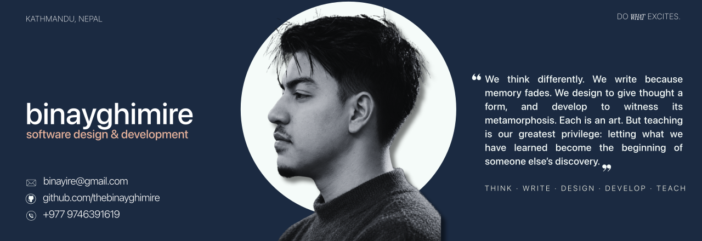

<!-- Upload this README.md and the assets folder to the public repository thebinayghimire/thebinayghimire. -->

  

  <strong>Software engineering in progress. Curiosity always on.</strong> 
  I build to understand how things work, then keep working until they make sense to use.

  <a href="#selected-work">Selected work</a> &nbsp; / &nbsp;
  <a href="#toolkit">Toolkit</a> &nbsp; / &nbsp;
  <a href="#in-progress">In progress</a> &nbsp; / &nbsp;
  <a href="https://github.com/thebinayghimire?tab=repositories">Repositories</a>

---

### A little context

I'm **Binay**, an IT computing student at **The British College, Kathmandu**, working toward a career in software engineering.

My interests sit where **useful software, clear interfaces, and practical infrastructure** meet. I enjoy turning everyday problems into applications and understanding the systems underneath them: how data moves, where it lives, and what happens when something fails.

- **Building:** web applications, practical utilities, and project prototypes.
- **Exploring:** backend development, databases, Linux, and deployment.
- **Paying attention to:** readable code, thoughtful UI, and understandable behavior.
- **Long-term direction:** becoming a software engineer who can take an idea from first sketch to a reliable product.

### Selected work

A selection of projects I've worked on, from coursework to independent prototypes. Scope and maturity vary by project.

<table>
<tr>
<td width="50%" valign="top">
<h3>01 / Document portal</h3>

<strong>Exploring controlled access to office documents.</strong>

A portal project centered on authentication, document browsing, and in-page previews. Design considerations include permissions, watermarking, and audit history.

PROJECT IN DEVELOPMENT · ACCESS CONTROL · DOCUMENT WORKFLOWS

</td>
<td width="50%" valign="top">
<h3>02 / EV booking prototype</h3>

<strong>Making local travel easier to browse and book.</strong>

A booking concept bringing together routes, pricing, date selection, and multilingual interfaces, with attention to the customer and administrator experience.

PROTOTYPE · BOOKING FLOWS · INTERFACE DESIGN

</td>
</tr>
<tr>
<td width="50%" valign="top">
<h3>03 / Personal notes app</h3>

<strong>A simpler way to capture and retrieve ideas.</strong>

A personal web app project exploring direct note URLs, search, tags, pinned notes, and Markdown import and export.

PERSONAL PROJECT · WEB APPLICATION · KNOWLEDGE ORGANIZATION

</td>
<td width="50%" valign="top">
<h3>04 / Java Turtle Graphics</h3>

<strong>Turning text commands into drawings.</strong>

A Java coursework project using object-oriented programming for drawing commands, input validation, and saving and loading work.

COURSEWORK · JAVA · OOP · INPUT HANDLING

</td>
</tr>
</table>

<a href="https://github.com/thebinayghimire?tab=repositories"><strong>Explore my public repositories →</strong></a>

<!-- Add direct repository or live-demo links inside the cards when you have verified their public URLs. -->

### Toolkit

Technologies I've used in coursework and personal projects. I'm continuing to deepen my understanding of each.

| Area | Technologies |
| :--- | :--- |
| **Programming** | Python · Java · C++ · JavaScript |
| **Web** | HTML · CSS · Flask |
| **Data & databases** | SQL · Oracle APEX · PL/SQL · pandas · NumPy |
| **Tools & systems** | Git · GitHub · Linux · Docker · VS Code |

### In progress

<table>
<tr>
<td width="33%" valign="top">
<strong>01 &nbsp; Build</strong>

Connect interfaces, application logic, and storage into complete, useful workflows.

</td>
<td width="33%" valign="top">
<strong>02 &nbsp; Understand</strong>

Go deeper into object-oriented design, backend behavior, and database decisions.

</td>
<td width="33%" valign="top">
<strong>03 &nbsp; Deploy</strong>

Learn how Linux, containers, and networking turn local applications into accessible services.

</td>
</tr>
</table>

### How I approach a project

**Understand the problem.** Define who the application serves and what it needs to do.  
**Build a working version.** Start with the core workflow and make its behavior clear.  
**Test the edges.** Look at invalid input, failure states, and the assumptions behind the code.  
**Refine the experience.** Improve the structure, documentation, and interface as the project develops.

<strong>Away from the editor</strong>

 

Manchester United, Formula 1, music, and an ongoing interest in visual design. I like the details that make something feel considered, whether it's an interface, a poster, or a well-built tool.

---

  <strong>Useful ideas. Thoughtful interfaces. Better engineering.</strong> 
  Learning in public, one project at a time.

  <a href="https://github.com/thebinayghimire">@thebinayghimire</a>

